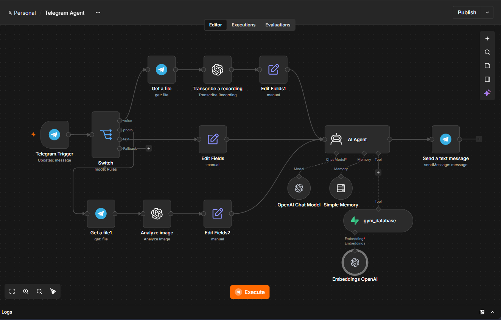
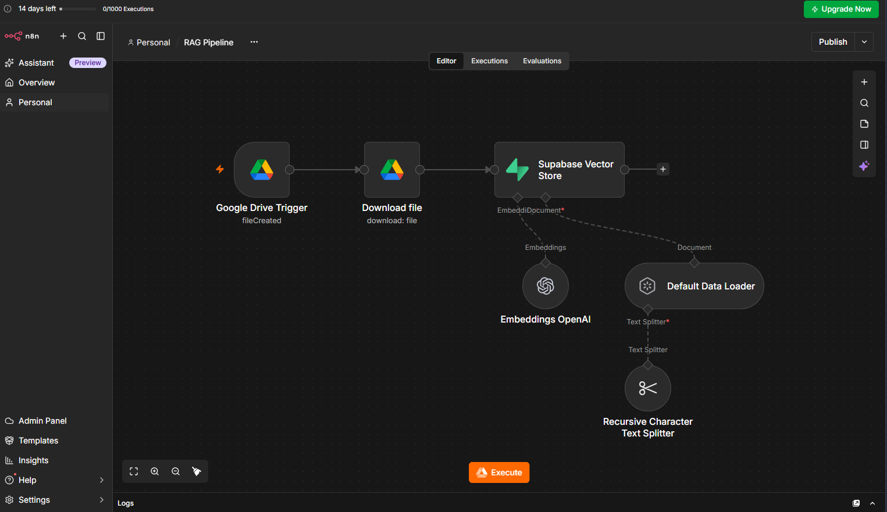

# Florence — Multimodal AI Gym Assistant

Florence is an AI-powered gym assistant built with **n8n, Telegram, OpenAI, and Supabase**. Designed for the fictional *Call It A Day Gym & Lifestyle Club*, Florence helps users ask questions about gym services, explore fitness information, send voice messages, and share images through Telegram.

The project combines workflow automation with Retrieval-Augmented Generation (RAG) to help ground business-specific answers in a gym knowledge base rather than relying entirely on a language model's general knowledge.

## Features

- **Text conversations:** Ask questions through Telegram.
- **Voice messages:** Convert voice notes into text for the AI agent to process.
- **Image analysis:** Analyze submitted images, including visible food and gym equipment.
- **Knowledge retrieval:** Search a Supabase vector database for relevant gym information.
- **Conversational memory:** Maintain a short conversation history using n8n Simple Memory.
- **Automated responses:** Return generated answers to users through Telegram.
- **Business-focused instructions:** Guide the assistant to avoid inventing gym prices, policies, facilities, or availability.

## Architecture

Florence consists of two n8n workflows.

### 1. Telegram Agent

Handles incoming messages and routes them according to their type.

```text
Telegram Trigger
       |
     Switch
       |
       +---- Text -----------+
       |                     |
       +---- Voice           |
       |       |             |
       |   Get Audio File     |
       |       |             |
       |   Transcription      |
       |       |             |
       +---- Photo            |
               |              |
          Get Image File      |
               |              |
          Image Analysis      |
               |              |
               +--------------+
                      |
                   AI Agent
                      |
          +-----------+-----------+
          |           |           |
       OpenAI       Memory    Supabase
       Chat Model              Retrieval
                      |
                Telegram Reply
```

### 2. RAG Pipeline

Processes knowledge-base documents and stores their embeddings for retrieval.

```text
Google Drive Trigger
        |
 Download File
        |
 Default Data Loader
        |
 Recursive Text Splitter
        |
 OpenAI Embeddings
        |
 Supabase Vector Store
```

The intended pipeline allows Florence to retrieve relevant information from the gym knowledge base when answering business-related questions.

**Synchronization limitation:** The current pipeline is configured around new-file events. Automatic handling of document edits and deletions has not been established, so the vector database may require manual maintenance when source documents change.

## Technology Stack

| Technology | Purpose |
|---|---|
| n8n | Workflow automation and orchestration |
| Telegram Bot API | User-facing messaging interface |
| OpenAI chat model | Conversational responses |
| OpenAI audio transcription | Voice-message processing |
| OpenAI image analysis | Image understanding |
| OpenAI embeddings | Converting document chunks into vectors |
| Supabase Vector Store | Knowledge retrieval |
| Google Drive | Knowledge-document source |
| n8n Simple Memory | Short-term conversational context |

## Repository Structure

```text
florence-multimodal-gym-assistant/
├── workflows/
│   ├── Telegram-Agent.json
│   └── RAG-Pipeline.json
├── data/
├── docs/
└── screenshots/
```

The workflow filenames above are intended names; use the actual filenames currently present in the repository until the files are renamed.

- `workflows/` — Exported n8n workflow definitions.
- `data/` — Knowledge-base source documents or sample data.
- `docs/` — Project documentation and design notes.
- `screenshots/` — Workflow and project screenshots.

## Setup

### Prerequisites

Before running the workflows, prepare:

- An n8n instance.
- A Telegram bot and Telegram credentials.
- An OpenAI API key with access to the models and operations used by the workflows.
- A Supabase project with the required vector-store table and compatible schema.
- A Google Drive connection for the RAG ingestion workflow.
- A collection of gym knowledge-base documents.

### Configuration

1. Import the sanitized workflow JSON files into n8n.
2. Configure the required Telegram, OpenAI, Supabase, and Google Drive credentials.
3. Verify that the Supabase vector table and embedding dimensions match the configured embedding model.
4. Configure the Google Drive trigger to watch the intended knowledge-base location.
5. Confirm that the documents are loaded, split into chunks, embedded, and stored successfully.
6. Test retrieval using known questions whose answers are present in the knowledge base.
7. Test text, voice, and image messages in Telegram.
8. Review the workflow execution logs and correct any version-specific node or expression issues before deployment.

**Important:** The exported workflows are inactive portfolio copies. Importing them does not automatically configure credentials or guarantee that every node will work without adjustment. Validate the workflows in your own n8n environment before activating them.

## Accuracy and Safety

Florence's instructions are designed to:

- Use retrieved knowledge for gym-specific facts.
- Avoid inventing prices, membership details, operating hours, or service availability.
- Communicate uncertainty when the knowledge base does not contain an answer.
- Treat food nutrition estimates as approximate.
- Avoid medical diagnoses or guaranteed health outcomes.
- Avoid claiming a booking is confirmed without an actual booking confirmation.

These are design intentions, not guarantees of perfect model behavior. Retrieval quality, document coverage, model output, and workflow configuration all affect the final response.

## Security

The repository is intended to contain sanitized workflow exports, not live credentials.

- Never commit API keys, bot tokens, database passwords, or private connection details.
- Configure credentials through n8n's credential manager.
- Use placeholder values in public examples.
- Review exported JSON files before publishing them.
- Restrict access to the Supabase project and use appropriate permissions.
- Avoid uploading real customer messages, personal information, or private business records to a public repository.

## Current Limitations

- The workflows require environment-specific credential setup.
- The RAG pipeline's edit and deletion synchronization behavior is not implemented in the documented design.
- The image-analysis output expression requires validation against actual n8n execution output.
- Unsupported Telegram message types may not receive a dedicated response.
- The project has not been represented here as production-tested or load-tested.

## Future Improvements

- Add a fallback response for unsupported Telegram messages.
- Validate and improve image-analysis output handling.
- Add update and deletion synchronization for knowledge-base documents.
- Build a repeatable test suite for text, voice, image, and retrieval paths.
- Add monitoring, error handling, and retry logic.
- Add a booking integration only when a real booking system is available.

## Project Purpose

This project demonstrates practical experience with AI workflow orchestration, multimodal messaging, document ingestion, vector search, conversational memory, and retrieval-grounded assistant design.

It is a learning and portfolio project, and its workflow exports should be validated in a configured environment before real-world use.

## Workflow Screenshots

### Telegram Agent


### RAG Pipeline

